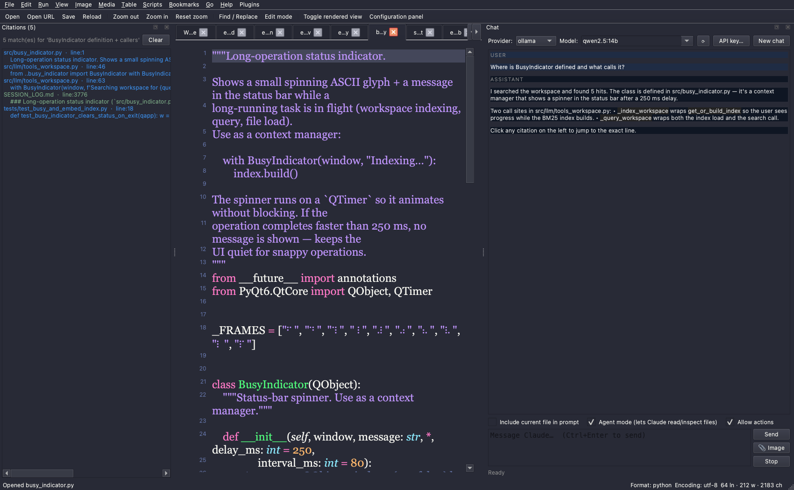
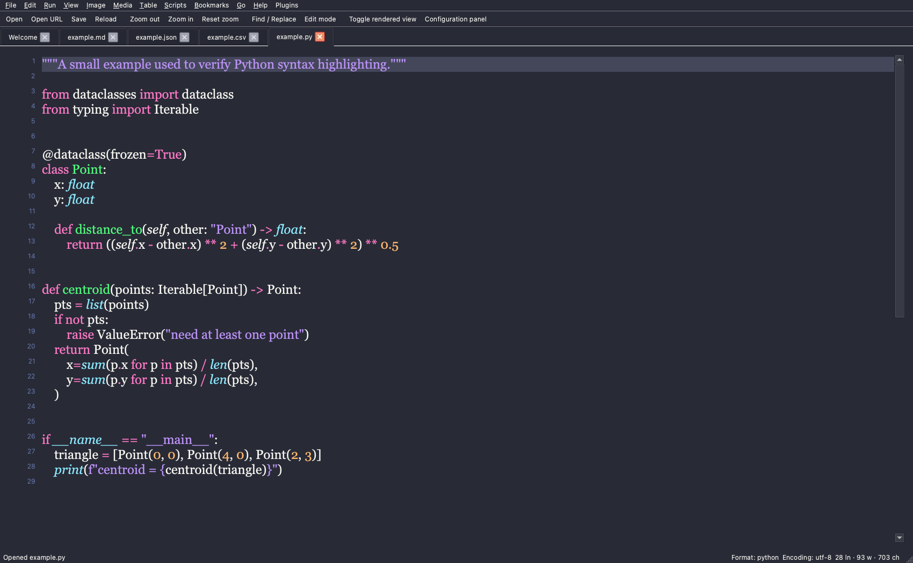
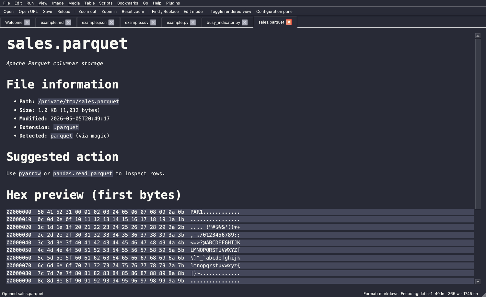
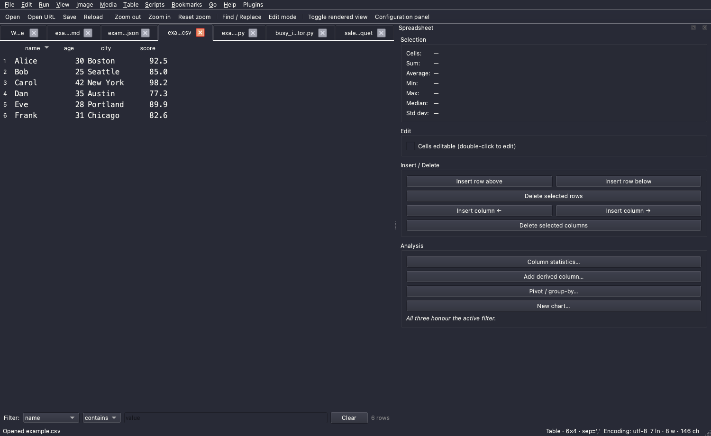
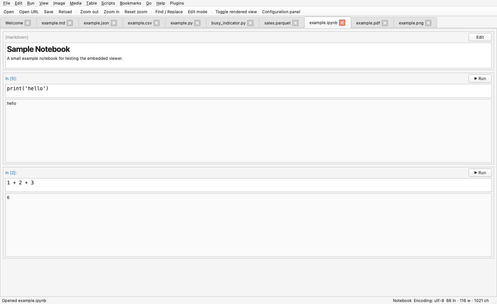
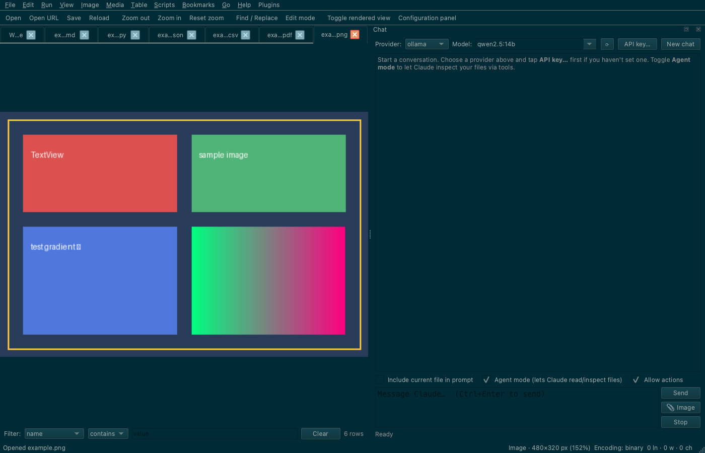
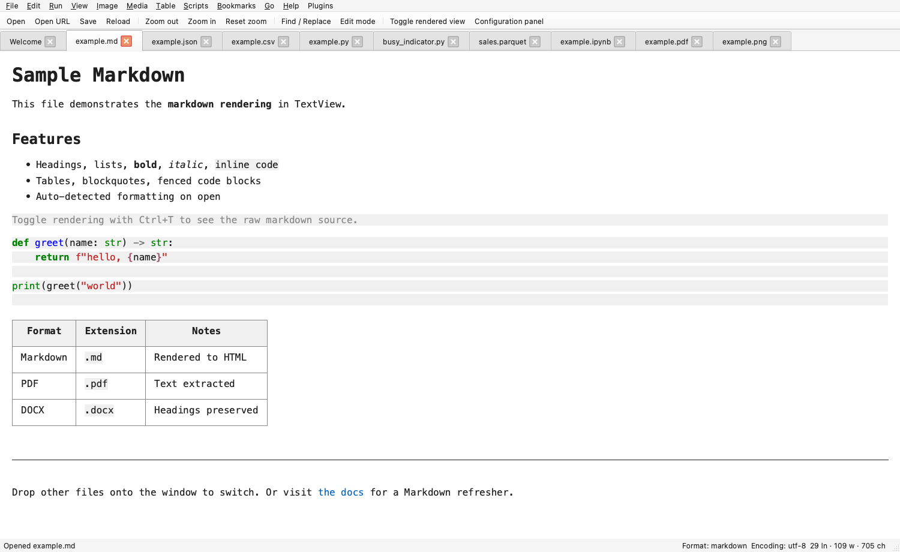

# TextView

[](https://github.com/gddickinson/textview/actions/workflows/tests.yml)


**A modular PyQt6 file viewer with an AI agent that knows your workspace.**

Open anything — code, markdown, PDF, DOCX, Jupyter notebooks, CSVs,
images, video — with live theming, syntax highlighting, and LSP
integration. Then talk to a chat agent that has tool access to your
files: it builds a workspace index, returns answers with clickable
citations, and (with explicit opt-in) can install packages and write
plugins to teach the app new file formats.



> *The agent in this shot has searched the workspace, picked five
> ranked citations (left), and explained what `BusyIndicator` does
> and where it's called. Click any citation to jump straight to the
> right line.*

## Why TextView

- **Workspace RAG with citations.** A BM25 index over the whole project
  (code, markdown, PDFs, notebooks, images by name) with optional
  embedding re-rank. Every agent answer comes back as `(file, line/page/cell)`
  citations the user can click to jump to. → [`docs/workspace-rag.md`](docs/workspace-rag.md)
- **An agent that can extend the app.** When TextView opens a file it
  doesn't recognise, it identifies the file by magic bytes and offers
  the chat agent. The agent can search the web, install a Python
  package, write an extension handler script, or write a full plugin
  — each gated by a separate per-tool safety flag. → [`docs/unknown-files.md`](docs/unknown-files.md)
- **Multimodal chat.** Drop images directly into the chat input — they
  go to the model as Anthropic-shape image content blocks. → [`docs/chat.md`](docs/chat.md)
- **Many formats, one window.** Text, code, markdown, JSON / YAML /
  TOML, CSV / TSV (sortable table mode with stats and chart picker),
  PDF, DOCX / RTF / EPUB / ODT, images (incl. animated WebP / TIFF /
  GIF), video, Jupyter notebooks. → [`docs/file-formats.md`](docs/file-formats.md)
- **LSP support** for Python (pyright), TypeScript, Go (gopls), Rust
  (rust-analyzer), C/C++ (clangd) — hover, go-to-definition, find
  references, diagnostics panel. → [`docs/lsp.md`](docs/lsp.md)
- **Embedded Jupyter:** notebook viewer / editor / runner with rich
  output (HTML, SVG, images, markdown), plus Python REPL and qtconsole.
  Single-kernel auto-start when you hit Run. → [`docs/notebook.md`](docs/notebook.md)
- **Live everything.** Theme, font, layout, line spacing — every
  display option is reactive. 10 built-in palettes (Dracula, Nord,
  Solarized, Sepia, …) switch without restart.
- **Modular by construction.** Every source file under 500 lines, one
  concern each, 302-test regression suite running in CI in under
  10 seconds. → [`INTERFACE.md`](INTERFACE.md), [`docs/architecture.md`](docs/architecture.md)

## Quick start

```bash
# conda (recommended on macOS — pins sqlite>=3.45 to avoid the
# anaconda+macOS ABI mismatch that breaks ipykernel and qtconsole)
conda env create -f environment.yml
conda activate textview
python main.py                # opens with welcome screen
python main.py path/to/file   # opens that file
```

```bash
# pip (Linux / Windows / advanced macOS)
python3 -m venv .venv && source .venv/bin/activate
pip install -r requirements.txt
python main.py
```

You can also drag-and-drop files onto the window to open them.

## Showcase

| | |
| --- | --- |
|  **Live syntax highlighting** with Pygments — tabs across the top let you flip through formats; line numbers, fold markers, current-line highlight, ten themes. |  **Unknown-file inspector.** Drop a `.parquet` (or anything else) onto the window — TextView identifies it via magic bytes and shows file info plus a hex preview, then offers the chat agent. |
|  **Table mode** for CSV / TSV. Sortable columns, filter bar, edit-mode, live selection stats (count / sum / avg / min / max / median / stddev), one-click chart picker, derived columns via Python expressions. |  **Jupyter notebooks** — full viewer / editor / runner. Edit cells, hit Run, the kernel auto-starts; outputs (text / HTML / SVG / PNG / markdown) render in place and persist on save. |
|  **Image viewer** with brightness / contrast / saturation / gamma sliders, eyedropper (click to copy hex), rubber-band crop, RGB histogram, and multi-frame navigation for GIF / WebP / TIFF. |  **Live theming + rich rendering.** Switch themes without restart. Markdown renders to HTML with syntax-highlighted code fences and tables. |

## Documentation

| Topic | File |
| --- | --- |
| First-time orientation | [`docs/overview.md`](docs/overview.md) |
| Every supported format | [`docs/file-formats.md`](docs/file-formats.md) |
| Workspace RAG (deep dive) | [`docs/workspace-rag.md`](docs/workspace-rag.md) |
| Unknown-file workflow + safety gates | [`docs/unknown-files.md`](docs/unknown-files.md) |
| Chat / LLM panel | [`docs/chat.md`](docs/chat.md) |
| LSP setup per language | [`docs/lsp.md`](docs/lsp.md) |
| Notebook viewer / runner | [`docs/notebook.md`](docs/notebook.md) |
| Agent scripts | [`docs/scripts.md`](docs/scripts.md) |
| Plugin loader | [`docs/plugins.md`](docs/plugins.md) |
| Lifecycle hooks | [`docs/hooks.md`](docs/hooks.md) |
| Agent / LLM tool surface | [`docs/agent-api.md`](docs/agent-api.md) |
| External control protocol | [`docs/control-server.md`](docs/control-server.md) |
| Code map (where things live) | [`docs/architecture.md`](docs/architecture.md) |
| Keyboard reference | [`docs/shortcuts.md`](docs/shortcuts.md) |
| Troubleshooting | [`docs/troubleshooting.md`](docs/troubleshooting.md) |

The same files power the in-app **Help** menu and the chat agent's
`list_docs` / `read_doc` / `search_docs` tools, so user docs and
agent context stay in sync.

## Architecture

`MainWindow` (`src/app.py`) owns a tabbed `TextViewer` and a small
constellation of dock widgets and controllers — each in its own focused
module. Display options live in `DisplaySettings` (a frozen-ish
dataclass) and propagate live through `SettingsManager.changed`. Data
flows file → `file_loader` → optional document extractor → format-aware
viewer (`CodeViewer`, `QPdfView`, `WebView`, `TableView`, `ImageView`,
`NotebookView`) → optional Pygments / markdown renderer.

LLM tools share a stable `AppAPI` façade so internal refactors don't
break user scripts. Plugins (`~/.config/TextView/plugins/`), agent
scripts (`~/.config/TextView/agent_scripts/`), format handlers
(`~/.config/TextView/format_handlers.json`), and lifecycle hooks
(`~/.config/TextView/hooks/`) are loaded at startup and reload
on demand.

[`INTERFACE.md`](INTERFACE.md) is the navigation map; every module's
responsibility is one row in a table there.

## Tests + CI

```bash
python -m pytest                  # full (~9s, 302 cases)
python -m pytest -m "not slow"    # CI subset (skips Jupyter subprocess tests)
python -m pytest tests/test_X.py  # one file
```

GitHub Actions runs the fast subset (293 / 302 cases) on every push
and pull request via [`tests.yml`](.github/workflows/tests.yml). The
README's `last commit` badge is auto-bumped by the same workflow on
every green push to `main`.

## Key shortcuts

| Shortcut | Action |
| --- | --- |
| `Ctrl+P` | Quick open file (fuzzy) |
| `Ctrl+K` | Command palette (every action) |
| `Ctrl+Shift+F` | Find in project |
| `Ctrl+F` | Find / replace (regex toggle) |
| `Ctrl+J` | Chat panel |
| `Ctrl+Shift+Z` | Citations panel |
| `Ctrl+I` | Metadata panel |
| `Ctrl+\`` | Terminal (PTY-backed) |
| `Ctrl+Alt+J` | Jupyter qtconsole |
| `F5` | Run current file (notebook: run cell) |
| `Alt+/` | LLM inline completion |
| `F2` | Go to definition (LSP) |
| `Shift+F12` | Find references (LSP) |
| `Ctrl+;` | Insert snippet |
| `Ctrl+?` | Show every shortcut (cheat sheet) |

`Run → Choose Python interpreter…` discovers system / conda / pyenv
Pythons; the selection persists and is reused by F5, the Python REPL,
qtconsole, and notebook kernel auto-start.

## License

Private — see [`SESSION_LOG.md`](SESSION_LOG.md) for development
history and [`ROADMAP.md`](ROADMAP.md) for shipped + parked features.
